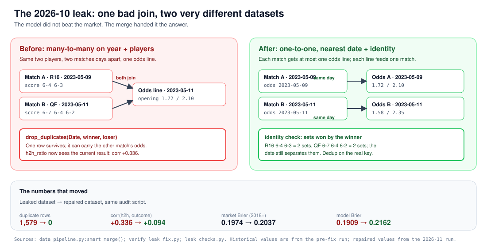
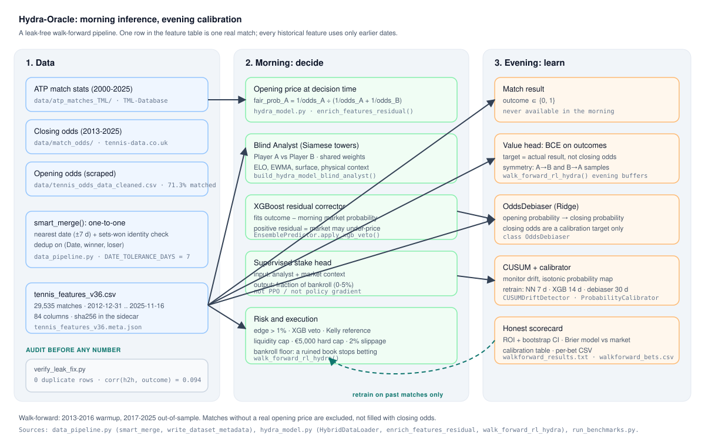
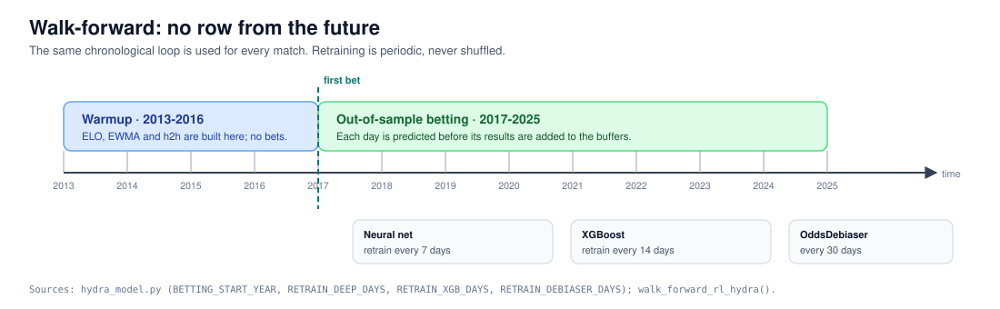
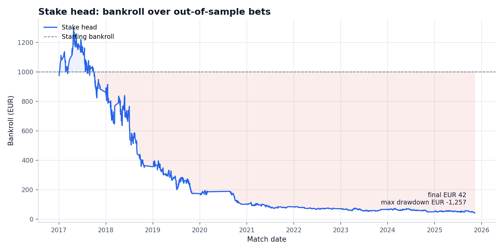
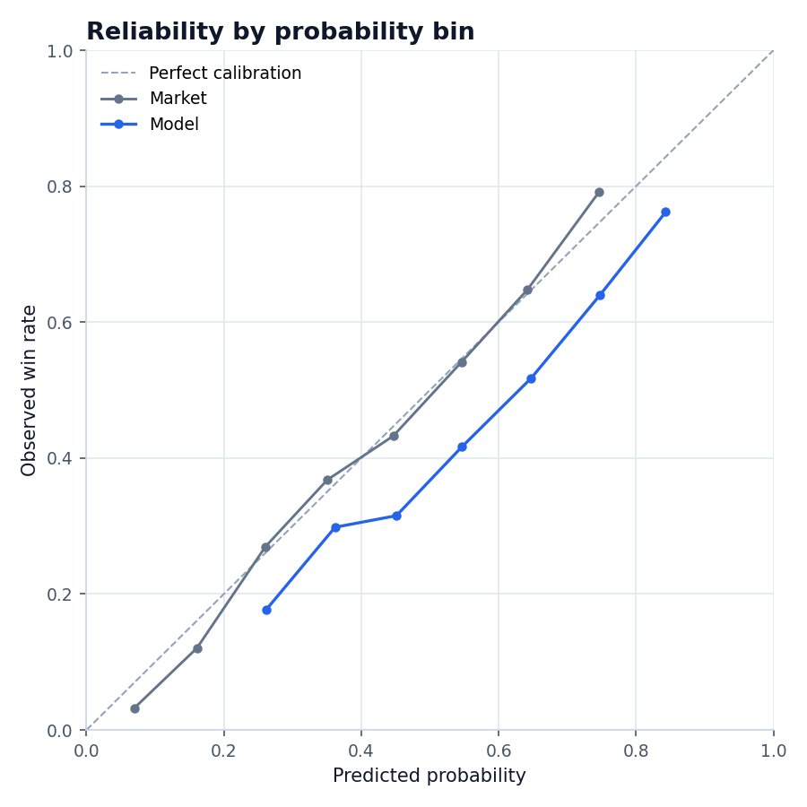
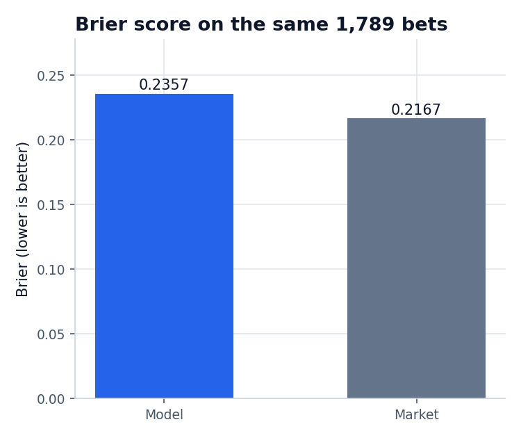

# trading-alpha-tennis

[](https://github.com/pietroschiona/trading_alpha_tennis/actions/workflows/tests.yml)
[](LICENSE)
[](requirements.txt)

**A Siamese + XGBoost tennis model, published after a data leak was found and fixed. The honest
result is negative, and that is the point.**

> The original project claimed **63.3% win rate / +30% ROI**. It was a data leak.
> After the repair: **1,825 bets, 42.2% win rate, ROI -5.22% (95% CI [-12.72%, +2.28%])**,
> model Brier **0.2373** vs market **0.2186** on the same bets. No edge.

---

## TL;DR

| | |
|---|---|
| What it is | Research code for ATP match prediction and betting simulation, with a full audit trail |
| What it is not | A profitable system, a live bot, or financial advice |
| Data | 29,535 matches, 2013-2025, TML-Database + tennis-data.co.uk + scraped opening odds (71.3% coverage) |
| Validation | Walk-forward: 2013-2016 warmup, 2017-2025 out-of-sample, one day at a time |
| Result | ROI -5.22%, CI contains 0, Brier worse than the market, calibration off by 11.6 points |
| The lesson | A win rate is not an edge; the market is the only honest benchmark |

Run of record: commit `3cbaf57`, 2026-11-23, data mode `opening_odds`. Artifacts:
[results](walkforward_results.txt) · [per-bet log](walkforward_bets.csv) · [manifest](walkforward_manifest.json) · [validation report](benchmarks/validation_report.md).

---

## The 2026-10 leak



*What you are looking at:* two matches between the same players, days apart, and one odds line.
*What it means:* the old `smart_merge()` joined odds on `year + players` within 15 days and
deduplicated on a key that collapsed both matches. The surviving row could carry the other
match's odds, and `h2h_ratio` ended up encoding the current result (`corr = 0.336`).
*What can break:* any loose join key. The fix is a one-to-one merge by nearest date with an
identity check on sets won and a dedup on `(date, winner, loser)`.

| Quantity | Leaked | Repaired |
|---|---:|---:|
| Dataset rows | 55,049 | 29,535 |
| Duplicate match rows | 1,579 | **0** |
| `corr(h2h_ratio, outcome)` | +0.336 | **+0.0938** |
| Market Brier (2018+) | 0.1974 | 0.2037 |
| Model Brier | 0.1909 (below market) | 0.2373 (above market)† |

† The leaked figure is the pre-fix run's own score. The repaired figure is measured on the 1,825
logged bets, where the market scores 0.2186 on the same bets — the like-for-like comparison.

The leak was found by u/1ma9nja on r/algobetting (thread `1tviwt7`). The audit that guards it now
is `verify_leak_fix.py`, and it must pass before any number is read.

---

## Architecture



*What you are looking at:* data flows through a one-to-one merge into features; opening odds feed
the morning decision; outcomes and closing odds feed the evening learners.
*What it means:* the model decides with information available before play and learns only from
matches already finished. Closing odds are a calibration target, never a morning input.
*What can break:* a match without an opening price is dropped, and coverage is 71.3% overall —
see [limitations](#limitations).

Components:

- **Blind Analyst** — Siamese towers with shared weights, one player per tower, win probability out.
- **XGBoost corrector** — fits `outcome − opening market probability`; a negative residual triggers
  a veto on the stake.
- **Stake head** — supervised, PnL-shaped; not reinforcement learning. Outputs a bankroll fraction.
- **OddsDebiaser** — Ridge map from opening to closing probability, used as a calibration aid.
- **Risk** — edge > 1%, tournament liquidity cap, €5,000 hard cap, 2% execution slippage.

There is no CUSUM monitor and no isotonic calibrator in the code. Earlier documentation claimed
both; they were never implemented and the claims were removed.

---

## Walk-forward validation



*What you are looking at:* the chronological loop. *What it means:* retraining is periodic and
strictly backward-looking; no row from the future enters training. *What can break:* a shuffled
buffer or a global scaler fitted on all dates would silently invalidate every score.

Details and file references: [`docs/methodology.md`](docs/methodology.md).

---

## Results



*What you are looking at:* the stake-head bankroll over the out-of-sample bets, from €1,000.
*What it means:* an early rise, then a long decline to €42. *What can break:* a curve like this
invites "just tune the stake"; the Brier and calibration below show the signal itself is the
problem, not the sizing.



*What you are looking at:* reliability by probability bin. *What it means:* the market (gray) sits
on the diagonal; the model (blue) says 45% and wins 34%. *What can break:* reading a single bin;
the pattern is systematic across the whole range.



*What you are looking at:* Brier score on the same 1,825 bets. *What it means:* the model is worse
than the market at pricing the bets it chose. *What can break:* comparing against 50% instead of
the market — that is how the old result looked impressive.

| Metric | Value |
|---|---|
| Bets | 1,825 |
| Wins | 771 (42.2%) |
| Average odds | 2.83 |
| Total staked | €18,351 |
| PnL | -€958 (StakeHead) |
| ROI | **-5.22%** |
| 95% bootstrap CI | **[-12.72%, +2.28%]** |
| p (one-sided, ROI ≤ 0) | 0.9127 |
| Model Brier | **0.2373** |
| Market Brier, same bets | **0.2186** |
| Calibration ECE | 0.1161 |

**Why 42% still loses.** The bets it wins average odds 2.254; the bets it loses average 3.248. Its
mean probability is 0.539 against a realized 0.4225, while the market's mean on the same bets is
0.421 — almost exactly the realized rate. The model is overconfident on long shots, and 2%
slippage turns that into a loss.

Full tables, strategy comparison and integrity tests: [`BENCHMARKS.md`](BENCHMARKS.md).

---

## Quick start

Supported: Python 3.10-3.12 (tested on 3.12), CPU only.

```bash
pip install -r requirements.txt

python download_data.py        # ATP matches + closing odds
python data_pipeline.py        # ~5 min -> tennis_features_v36.csv (20 MB)

python verify_leak_fix.py      # MUST pass before trusting any number
python -c "import hydra_model as m; raise SystemExit(m.main())"   # ~20 min
python run_benchmarks.py       # statistical + probability report
python make_figures.py         # light-theme README figures
```

The canonical run **requires** the ~1 GB scraped opening-odds file
(`data/tennis_odds_data_cleaned.csv`, see [`docs/data-sources.md`](docs/data-sources.md)). Without
it `main()` exits with code 1. A clearly labelled degraded mode exists for debugging:

```bash
TRADING_ALPHA_ALLOW_CLOSING_FALLBACK=1 python -c "import hydra_model as m; raise SystemExit(m.main())"
```

Its output records `Data mode: closing_fallback` and is never used for published numbers.

---

## What is in the repository

```
hydra_model.py          model, walk-forward engine, risk, artifacts
data_pipeline.py        raw data -> features, one-to-one odds merge
run_benchmarks.py       returns, Brier, calibration, integrity tests
verify_leak_fix.py      mandatory anti-leak audit
make_figures.py         README figures from walkforward_bets.csv
tests/                  unit tests (34)
docs/                   index, architecture, methodology, data card, runbook, reproducibility
docs/figures/           architecture, leak and walk-forward diagrams + result charts
walkforward_*.{txt,csv,json}   published run artifacts
benchmarks/             generated validation report
```

Start reading at [`docs/index.md`](docs/index.md).

---

## Limitations

- **Sample selection.** The model only sees the 71.3% of matches with opening odds; coverage falls
  to 57.8% in 2024. The betting sample skews toward well-covered tournaments.
- **Market as opponent.** Pinnacle's opening price is the best public estimate. A model that
  appears to beat its Brier by a lot is a leakage symptom first.
- **One run, one seed.** The bootstrap CI is wide because it should be.
- **No live execution.** Slippage is a flat 2%; stake caps are simulated.
- **No CLV.** The bet log records opening prices; closing-line value is future work, not estimated.

---

## FAQ

**Is the 42% win rate good?**
Not by itself. At average odds 2.83 the break-even rate is about 35%, so 42% looks positive — but
the wins are cheap and the losses expensive, and the ROI is negative.

**Why publish a negative result?**
Because the alternative is the previous version of this repository, which advertised a 63% win rate
produced by a data leak. A reproducible negative result is worth more than an unreproducible
positive one.

**Can I use this to bet?**
No. The measured result argues against it, and betting can be harmful.

**Where do the numbers come from?**
`walkforward_results.txt` (headline), `walkforward_bets.csv` (per bet), `benchmarks/validation_report.md`
(tests). `run_benchmarks.py` marks the report **VOID** if the dataset hash does not match.

---

## Contributing, citation, license

- [`CONTRIBUTING.md`](CONTRIBUTING.md) — the one rule: never loosen the temporal contract.
- [`CITATION.cff`](CITATION.cff) — citation metadata.
- Apache-2.0, see [`LICENSE`](LICENSE).

Author: Pietro Schiona — [GitHub](https://github.com/pietroschiona).
