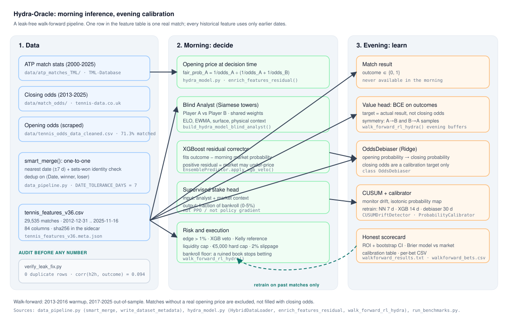

# Architecture

*What you are looking at:* three lanes — data, morning inference, evening learning. Arrows are
`path:line` references in the schema below. *What it means:* the model decides with prices
available before play and learns only from matches already finished. *What can break:* if opening
odds are missing for a match, the match is dropped; if the evening learners ever see the current
result, the scorecard stops being out-of-sample.

## Data lane (`data_pipeline.py`, `hydra_model.py`)

| Component | Where | Job |
|---|---|---|
| ATP match loader | `data_pipeline.py` (TML CSVs) | one row per match, Sackmann schema |
| Closing odds loader | `data_pipeline.py` (`data/match_odds/*.xlsx`) | Pinnacle closing prices, calibration target |
| `smart_merge()` | `data_pipeline.py:smart_merge` | one-to-one odds-to-match join, nearest date ±7 days, identity check on sets won |
| Dataset metadata | `data_pipeline.py:write_dataset_metadata` | sidecar with rows, dates, sha256 |
| Opening-odds loader | `hydra_model.py:180` `HybridDataLoader` | reads the ~1 GB scraped CSV, priority bookmaker list, one line per match |
| Feature builder | `hydra_model.py:621` `enrich_features_residual` | ELO, EWMA, surface, physical context, market context |

The loader never prices a match with closing odds in the canonical mode: `main()`
(`hydra_model.py:1592`) drops uncovered matches and refuses to run if no match is paired.

## Morning lane (`hydra_model.py`)

| Component | Where | Job |
|---|---|---|
| Blind Analyst | `build_hydra_model_blind_analyst` (`hydra_model.py:884`) | Siamese towers with shared weights; outputs win probability from player and physical features |
| XGBoost corrector | `EnsemblePredictor.train_xgb` (`hydra_model.py:966`) | fits `outcome − morning market probability`; the residual is the only "edge" signal |
| Veto | `apply_xgb_veto` (`hydra_model.py:1001`) | a residual below `XGB_VETO_THRESHOLD` (-0.02) sets the stake to zero |
| Stake head | `create_pnl_loss` (`hydra_model.py:856`) | supervised, PnL-shaped regression; outputs a bankroll fraction in [0, 0.05]. **Not reinforcement learning.** |
| Risk caps | `walk_forward_rl_hydra` (`hydra_model.py:1023`) | edge > 1%, liquidity multiplier, €5,000 legal cap, 2% execution slippage, ruin floor |

## Evening lane (`hydra_model.py`)

| Component | Where | Job |
|---|---|---|
| Outcome buffer | `walk_forward_rl_hydra` | after the match, append features + outcome (and the A/B mirrored copy) |
| OddsDebiaser | class `OddsDebiaser` (`hydra_model.py:458`) | rolling Ridge map from opening probability to closing probability |
| Retraining | `RETRAIN_DEEP_DAYS = 7`, `RETRAIN_XGB_DAYS = 14`, `RETRAIN_DEBIASER_DAYS = 30` | rolling retrain on the past buffer only |
| Scorecard | `write_results` (`hydra_model.py:1534`) | ROI, bootstrap CI and Brier are computed downstream by `run_benchmarks.py` |

There is no CUSUM monitor and no isotonic calibrator in this codebase. Earlier documentation
claimed both; they were never implemented, and the claims were removed rather than mocked up.

## Temporal contract

Every historical feature is shifted by one observation per player (`compute_ewma_features`,
`hydra_model.py:569`). ELO updates after the match. The walk-forward loop processes one match day
at a time, predicts before updating the buffers, and never shuffles. The validation and leak audit
that keep this contract honest are in [`RUNBOOK.md`](RUNBOOK.md) and [`dataset.md`](dataset.md).
